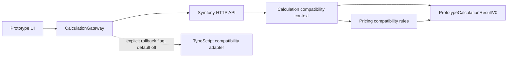

# Prototype v0 — context map миграции

Дата: 28 августа 2026 года.

## Границы

- `Prototype UI` владеет отображением и редактируемым frontend draft, но не формулами.
- `CalculationGateway` является frontend-портом. По умолчанию используется HTTP adapter к Symfony; старый TypeScript adapter оставлен за выключенным флагом до подписанной parity. При недоступности API автоматического переключения нет.
- `Calculation` владеет геометрическими промежуточными значениями, деталями, фурнитурой, сроком и предупреждениями текущего алгоритма.
- `Pricing` логически отделено от Calculation, хотя в исходной функции они пока расположены вместе. В Symfony правила геометрии и pricing разделены внутри compatibility-контекста. Денежные операции десятичные; числовое отличие от binary floating point зафиксировано в [ADR-0003](adr/0003-migration-runtime-boundaries.md) и ожидает решения владельца.
- Контракты находятся в `contracts/prototype-v0`, fixtures — в `contracts/fixtures/prototype-v0.json`.

Эта схема описывает только техническую миграцию исходного расчёта. По принятому исключению [ADR-0006](adr/0006-cabinet-builder-pilot.md) добавлены Identity, Cabinet, Project и публикации Marketplace. Их текущие контракты и сценарий описаны в [документации пилота](cabinet-pilot.md). Catalog, подбор производителей и предложения этим исключением не вводятся.
